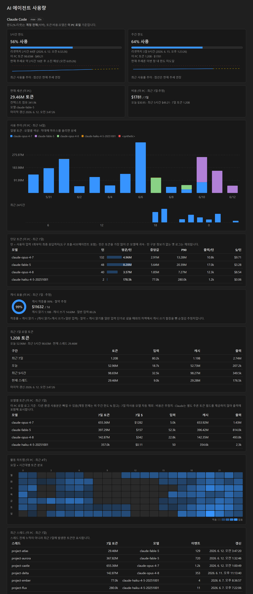
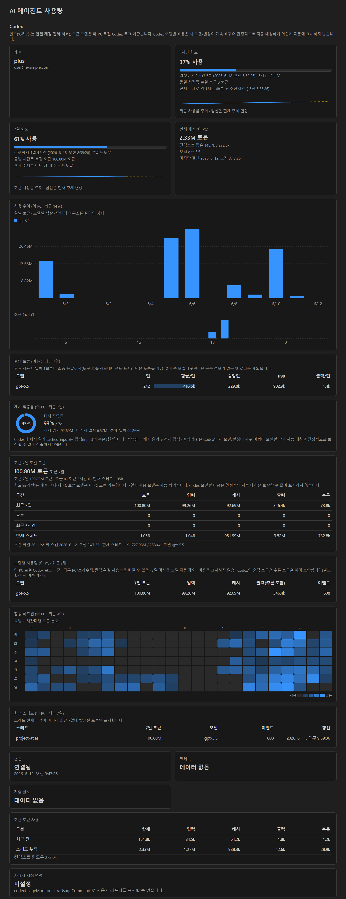

# AI 에이전트 사용량 모니터 (Codex + Claude)

VS Code에서 **Codex와 Claude Code 사용량을 동시에** 항시 볼 수 있게 해주는 로컬 확장입니다. *(마켓플레이스용 영문 소개: [docs/README.en.md](docs/README.en.md))*

두 에이전트 모두 **별도 로그인 없이** 이미 로그인된 CLI의 자격증명을 그대로 재사용합니다.

- **Codex**: 로컬 `codex app-server --stdio` 를 실행해 현재 세션의 계정/제한/토큰을 실시간으로 받아옵니다. (`auth.json` 토큰을 복사하지 않음) 비용은 표시하지 않고 한도·토큰·모델 사용량에 집중합니다.
- **Claude Code**: 공식 `/usage` 명령이 호출하는 것과 동일한 OAuth usage 엔드포인트를 `~/.claude/.credentials.json` 의 토큰으로 호출해 계정에 적용된 한도 창(5시간·주간·모델 전용 등)을 받고, `~/.claude/projects/**/*.jsonl` 트랜스크립트에서 토큰·비용을 집계합니다. 자격증명은 **읽기만** 합니다 — 토큰을 갱신하거나 파일에 쓰지 않으므로 Claude Code의 로그인(계정 전환 포함)을 건드릴 일이 없습니다. 토큰 갱신은 Claude Code가 쓰일 때 스스로 하며, 이 PC의 어느 창에서든 Claude Code를 쓰는 동안에는 한도가 계정 전체 합계(다른 창·웹·다른 기기 사용분 포함)로 계속 갱신됩니다. 이 PC에서 Claude Code를 오래(토큰 유효 시간, 보통 8시간) 쓰지 않아 토큰이 만료되면 서버를 부르지 않고 마지막 값과 '마지막 확인 시각'만 차분히 표시하다가, Claude Code가 토큰을 바꾸면(자격증명 파일 변경 감지) 약 1초 뒤로 다시 조회를 잡아 그동안의 사용분까지 반영합니다(서버가 요구한 재시도 대기 중이면 그 시각이 지난 뒤 조회).

## 스크린샷

**Claude Code 섹션** — 한도 사용률 그래프(창 시작 → 리셋 · 실선 = 실제로 쓴 굴곡 · 점선 = 창 시작 이후 평균) · 최근 14일 사용 추이(모델별 스택) · 모델별 턴당 토큰(평균/중앙값/P90/$) · 캐시 효율(적중률·절약 추정) · 요일×시간 활동 히트맵:



**Codex 섹션** — 동일한 추이/턴당 통계/히트맵 시각화(비용 표시 제외 정책 유지):



> 스크린샷의 토큰·차트 수치는 실제 로컬 로그를 집계한 값이며, 계정·한도 %·스레드 이름은 예시/익명화된 값입니다. `node scripts/make-screenshots.js` 로 재생성할 수 있습니다.

## 기능

- VS Code 왼쪽 상태바에 `Codex`, `Claude` 두 항목을 나란히 표시
- 클릭하면 통합 대시보드 열기. 감지된 에이전트만 자동 표시하며, 하나만 감지되면 해당 섹션을 먼저 보여줍니다.
- **Claude**: 서버가 보고하는 한도 창별 사용률(%)·리셋까지 남은 시간(5시간·주간·모델 전용 주간 등, 적용되는 것만), 요금제 표시명(개명 반영), 구간별(5h/7일) 토큰·비용, 현재 세션 토큰/컨텍스트 점유, 모델별(최근 7일) 토큰·비용, **최근 스레드(이 PC·최근 7일)**, 다른 환경 합치기
- **Codex**: 연결/계정(요금제 표시명), 사용 한도 창(창 길이로 5시간/주간 등 분류 · 모델 전용 한도 포함)의 사용률 %·리셋·기간, 크레딧, 지출 한도, 최근 토큰, 최근 7일 로컬 토큰·모델·스레드, **다른 환경 합치기**, 사용자 지정 명령 출력
- 토큰은 트랜스크립트 파일 변경 감지로 실시간에 가깝게 갱신

### 시각화 / 인사이트 (Claude·Codex 공통, v0.8+)

외부 라이브러리 없이 인라인 SVG로 그려 오프라인·CSP 환경에서도 동작합니다.

- **사용 추이 차트**: 최근 14일 일별 토큰을 모델별 색상 스택 막대로, 최근 24시간을 시간별 미니 막대로 표시 (막대 위 마우스 오버로 상세)
- **턴당 토큰 통계**: 모델별로 1턴(사용자 입력→최종 응답, 도구 호출·서브에이전트 포함)의 평균·중앙값·P90·출력 토큰을 표시. 평균만이 아니라 분포를 함께 보여 "긴 턴 하나가 평균을 끌어올렸는지" 구분 가능. Claude는 턴당 추정 비용($)도 표시
- **캐시 효율**: Claude는 적중률 도넛 + "캐시 덕에 절약한 추정 비용"(캐시 쓰기 할증을 차감한 순절감), Codex는 적중률 도넛(Codex의 `cached_input`은 `input`의 부분집합 의미론. 절약액 $는 새 모델/별칭이 자주 바뀌어 단가 자동 매칭을 안정적으로 보장할 수 없어 산출하지 않음)
- **활동 히트맵**: 최근 4주 요일×시간대 토큰 분포 — 언제 많이 쓰는지 한눈에
- **한도 그래프**: 각 한도 창 카드 안에 가로축 = 창 시작 → 리셋으로, 실선 = 실제로 쓴 사용률의 굴곡, 점선 = 창 시작 이후 평균이 유지될 때의 선과 100% 도달 예상점을 표시. 실선은 확장이 서버에서 받은 실제 값만 쓴다(추정 없음): 본 값을 계정별로 저장해 VS Code 를 다시 켜도·여러 창에서도 이어 그린다(확장 전용 저장 폴더, 계정은 알아볼 수 없는 값으로만 구분 · 지금 계정을 확인할 수 없으면 저장도 저장 기록과 잇기도 하지 않고, 확인된 계정의 값과도 잇지 않음 · 리셋 시각이 같은 창의 기록만 잇고 어느 창인지 모호한 기록은 잇지 않음). 서버가 지난 흐름을 주지 않으므로 실선은 확장이 실제로 받은 관측점만으로 그린다 — 이번 창은 확장이 본 때부터, 그다음 창들도 확장이 켜져 서버 값을 받는 동안만 점이 쌓인다. VS Code 를 끈 동안이나 조회가 안 된 동안(토큰 만료·연결 실패 등)의 세부 흐름은 복원하지 않고 나중에 메우지도 않으며, 그 구간은 앞뒤 관측점을 **흐린 선**으로 잇는다 — 값을 계속 받은 동안은 진한 실선이다(새 값의 관측 시각 사이가 30분과 평소 조회 간격의 3배 중 긴 쪽보다 벌어지면 "값을 받지 못한 구간" — 서버가 옛 관측 시각만 되풀이한 동안도 포함. 다른 VS Code 창이 받은 새 값도 받은 것으로 친다)(Codex 로컬 세션 기록은 기록마다 어느 계정으로 실행했는지 알 수 없어 쓰지 않는다). 그래프 기록은 소진 예상 계산에는 쓰지 않는다.

## 설치 / 적용

[Releases](https://github.com/kimbyungsu/codex-usage-monitor/releases) 에서 가장 최신 `codex-usage-monitor-*.vsix` 를 내려받아 설치합니다.

```powershell
# 내려받은 폴더에서 가장 최신 버전 자동 설치
code --install-extension (Get-ChildItem codex-usage-monitor-*.vsix | Sort-Object Name | Select-Object -Last 1).FullName --force
```

또는 VS Code 확장 패널 → `...` → `Install from VSIX...` 로 설치한 뒤 `Developer: Reload Window` 를 실행하세요.

상태바 왼쪽에 `Codex …` 와 `Claude …` 항목이 보입니다. 클릭하면 대시보드가 열립니다.

다른 PC에서 GitHub 소스로 빌드해 설치하려면:

```powershell
git clone https://github.com/kimbyungsu/codex-usage-monitor.git
cd codex-usage-monitor
npm install
npm run package
code --install-extension (Get-ChildItem codex-usage-monitor-*.vsix | Sort-Object Name | Select-Object -Last 1).FullName --force
```

`Developer: Reload Window` 후 적용됩니다.

명령 팔레트:

- `Codex 사용량 모니터: 대시보드 열기`
- `Codex 사용량 모니터: 새로고침` (Codex + Claude 모두)
- `Codex 사용량 모니터: 다시 연결` (Codex)
- `AI 사용량 모니터: Claude 새로고침`

## 설정

Codex

- `codexUsageMonitor.codexCommand`: Codex 실행 파일 경로/명령 (기본 `codex`)
- `codexUsageMonitor.refreshIntervalSeconds`: Codex 새로고침 주기 (기본 `60`초)
- `codexUsageMonitor.extraUsageCommand`: 별도 사용량 리포터 명령 출력 표시
- `codexUsageMonitor.codexExtraSessionPaths`: 다른 환경의 Codex `sessions` 폴더(또는 `.codex` 홈) 합산 경로 목록 (대시보드 "다른 환경 합치기"로도 추가 가능)
- `codexUsageMonitor.showStatusBar`: Codex 상태바 표시 여부
- `codexUsageMonitor.notifyOnStartup`: 시작 안내 알림 표시 여부

Claude

- `codexUsageMonitor.showClaudeStatusBar`: Claude 상태바 표시 여부
- `codexUsageMonitor.claudeConfigDir`: Claude 설정 폴더 경로 (비우면 `CLAUDE_CONFIG_DIR` 또는 `~/.claude`)
- `codexUsageMonitor.claudePlanRefreshSeconds`: 플랜 한도 새로고침 기본 주기 (기본 `120`초, 최소 30초). 이 값이 하한이며, 429 시 간격이 ×2로 늘었다가(최대 15분) 이 값으로 수렴(그 아래로 안 내려감).
- `codexUsageMonitor.claudeTokenRefreshSeconds`: 토큰 재집계 주기 (기본 `15`초, 파일 변경 감지와 병행)
- `codexUsageMonitor.claudeExtraProjectPaths`: 다른 환경의 projects 폴더 합산 경로 목록 (대시보드 "다른 환경 합치기"로도 추가 가능)

## 개발 / 테스트

통합 테스트 하니스(`@vscode/test-electron`)로 지정한 VS Code 버전(기본 1.96 = Node 20)을 내려받아 확장 호스트 안에서 TLS/usage 호출을 실측합니다.

```powershell
npm test                          # 기본 1.96.0에서 실행
$env:VSCODE_TEST_VERSION="1.105.0"; npm test   # 버전 지정
npm run test:limits               # 한도 창 정규화·표시 회귀 시험(플레인 Node, 확장 호스트 불필요)
```

설치 파일 만들기:

```powershell
npm run package          # codex-usage-monitor-<버전>.vsix (publisher local — Releases 배포·기존 설치본 덮어쓰기 업그레이드용)
npm run package:market   # codex-usage-monitor-<버전>-marketplace.vsix (publisher kimbyungsu · 영문 README — 마켓 관리 페이지 업로드용)
npm run icon             # docs/icon.png 재생성(외부 라이브러리 없음)
```

> 두 파일은 확장 ID가 다릅니다(`local.codex-usage-monitor` / `kimbyungsu.codex-usage-monitor`). 한 PC에 둘 다 설치하면 상태바 항목이 두 벌 생기니 하나만 설치하세요. 마켓은 같은 버전 재업로드를 거부하므로 게시할 때마다 버전을 올려야 합니다.

> **Windows 경로 제약**: `@vscode/test-electron`는 확장 경로에 **공백/일부 비ASCII(한글 등)** 가 있으면 테스트 호스트로 넘기는 인자가 공백에서 잘려 실패합니다. 이 저장소 경로(예: `에이전트 활용`)가 그렇다면, **공백·한글이 없는 경로로 복사**한 뒤 거기서 `npm test` 를 실행하세요.
> ```powershell
> robocopy . C:\dev\codex-usage-monitor /E /XD node_modules .vscode-test | Out-Null
> robocopy .\node_modules C:\dev\codex-usage-monitor\node_modules /E | Out-Null
> cd C:\dev\codex-usage-monitor; npm test
> ```

환경 특이사항(필요할 때만):
- **TLS 가로채기 프록시/백신 환경**: npm 설치와 VS Code 다운로드가 인증서 검증으로 막히면, OS 신뢰 인증서를 PEM으로 묶어 물려주세요.
  ```powershell
  node -e "const fs=require('fs'),tls=require('tls');fs.writeFileSync('.systemca.pem',[...tls.getCACertificates('default'),...tls.getCACertificates('system')].join('\n'))"
  $env:NODE_EXTRA_CA_CERTS=(Resolve-Path .systemca.pem).Path; npm test
  ```
- **Electron 기반 셸(예: VS Code 통합 터미널/일부 에이전트)에서 실행 시** `ELECTRON_RUN_AS_NODE=1`이 상속되면 테스트용 Code.exe가 GUI 대신 Node로 떠 실패합니다. 그럴 땐 `Remove-Item Env:\ELECTRON_RUN_AS_NODE` 후 실행하세요. 일반 터미널/CI에서는 해당 없음.

> 실측 결과(이 저장소): VS Code **1.96.0(Node 20.18.1)** 확장 호스트에서 usage 호출이 **인증서 검증을 통과**하고 실제 한도 데이터를 수신함을 확인(`1 passing`). Node 20에는 `tls.getCACertificates`가 없어 코드의 병합은 no-op이며, VS Code의 시스템 인증서 처리가 이를 보장합니다.

## 참고 / 한계

- **Claude 한도(창별 %·리셋)** 는 `/usage` 와 동일한 실제 값입니다. 단, 이 값은 공식 문서화되지 않은 내부 OAuth usage 엔드포인트(공식 Claude Code CLI가 `/usage` 에서 쓰는 것과 동일)에서 받아옵니다. **비공식 경로라 향후 변경 시 한도 표시가 동작하지 않을 수 있습니다.** 그 경우에도 토큰·비용·모델 집계(로컬 JSONL 기반)는 독립적으로 계속 동작하며, 상태바는 로컬 토큰 정보로 자동 폴백합니다.
- **Claude 비용(USD)** 은 모델별 공개 단가로 환산한 추정치이며, 구독 사용자의 실제 청구액이 아니라 'API 환산 비용'입니다.
- **TLS / 인증서**: 한도 조회는 HTTPS로 이뤄지며 **VS Code의 시스템 인증서·프록시 처리**(`http.systemCertificates` 기본 켜짐, `http.proxy`)를 그대로 따릅니다. 사내 백신/프록시 루트가 OS 신뢰 저장소에 있으면 검증이 정상 통과합니다. 추가로, 확장 호스트 Node가 지원하는 신버전(Node 22+의 `tls.getCACertificates`)에서는 OS 인증서를 직접 병합해 한 번 더 보강합니다. 인증서 검증 실패가 계속되면 VS Code의 위 설정을 확인하세요. (인증서 검증을 끄는 옵션은 OAuth 토큰 보호를 위해 사용자 설정으로 제공하지 않습니다.)
- **Codex 비용 제외**: Codex 로그의 모델 ID와 별칭은 새 모델이 나올 때마다 바뀔 수 있어 모델별 비용 자동 매칭을 안정적으로 보장하기 어렵습니다. 그래서 Codex는 비용을 표시하지 않고, 계정 한도·리셋·로컬 토큰·모델별 토큰만 표시합니다.
- **데이터 범위**: 한도 %는 계정 전체(모든 환경 합산 — 항상 서버 값), 토큰·모델은 이 PC 로컬 로그 기준입니다. "다른 환경 합치기"는 토큰·모델·비용·스레드 집계에만 쓰이고 한도 %·한도 그래프에는 영향이 없습니다. Claude 비용은 로컬 로그의 모델별 공개 단가로 환산한 추정치입니다. 다른 환경을 합치려면 대시보드 하단 "다른 환경 합치기" 에서 폴더를 추가하세요. (Claude·Codex 양쪽 모두 지원)
- **대용량 트랜스크립트**: Claude/Codex 세션 로그(`.jsonl`)는 장기 세션에서 수백 MB~GB까지 커질 수 있습니다. 파일 전체를 한 번에 문자열로 읽으면 Node 문자열 한계(~512MB) 초과 시 읽기에 실패해 해당 세션이 통째로 집계에서 누락될 수 있으므로, 청크 스트리밍으로 줄 단위 파싱합니다(크기 무관 안전, 멀티바이트 경계 보존). 활성 세션은 증분 파싱으로 가볍게 갱신합니다. 이 처리는 최근 7일 토큰뿐 아니라 모델별·최근 스레드·현재 세션 등 로컬 집계 출력 전체에 동일하게 적용됩니다.
- **한도 소진 예상(창 시작 이후 평균)**: 각 계정에 서버가 알려준 리셋 시각과 그 창의 시작(서버가 주면 그 값, 없으면 리셋 − 창 길이)을 기준으로, "창이 시작된 뒤 지금까지 쓴 평균 속도"가 유지되면 리셋 전에 100%에 닿는지 판단합니다. 예: 주간 창 3일째 52% → 시간당 약 0.72% → "일 11/15 오후 5:27 무렵 소진 (리셋 월 11/16 오후 10:00 전)". 리셋 무렵이면 보고값 반올림(±0.5%p)을 감안해 "리셋 무렵 경계(약 92~103%)"로, 안 넘치면 "리셋 시 약 97%"로 표시합니다. 예전처럼 최근 1~2시간 속도만 보지 않으므로, 잠깐 쉬었다고 "평화"로 바뀌거나 잠깐 몰아 썼다고 겁을 주지 않습니다. Claude·Codex 같은 계산 한 곳을 씁니다.
- **리셋 기준은 고정값이 아님**: Codex는 리셋 시각이 몇 초씩 흔들리고, 예정보다 일찍 창이 통째로 새로 시작되며(사용률이 0~수 %로 떨어지고 리셋이 크게 밀림), 두 기준이 번갈아 오기도 합니다(Claude도 같을 수 있음). 그래서 예상은 기억해 둔 기준 없이 매 관측의 최신 리셋 시각으로 다시 계산하고, 같은 창(처음 본 리셋 시각 ±2분)에서 사용률이 내려가면(한도 복원·보정 — 정기 리셋 요일·시각은 그대로) 그 창이 끝날 때까지 숫자 예상을 보류합니다. 확장이 꺼져 있던 동안의 복원 등은 감지하지 못할 수 있습니다. 같은 한도의 관측 시각이 "서버 산출 시각"과 "응답 받은 시각" 사이에서 바뀌면 둘을 정확히 비교할 수 없어, 옛 값으로 되돌아가지 않는 쪽을 택해 다음 관측까지 잠깐 늦게 반영될 수 있습니다. 리셋 기준이 너무 자주 바뀌어 같은 창 기록이 넘치면 "추적 기록 부족 — 예상 보류"로 따로 표시합니다.
- **관측 시각·오래된 값**: 예상은 그 값을 관측한 시각 기준으로 계산하고, 화면은 1분마다 다시 그려 남은 시간·리셋 경과("새 값 대기")·예상 시각 경과("새 관측 필요")를 반영합니다. 조회가 실패하거나 오래되면 "마지막 관측 HH:MM 기준"을 덧붙입니다. 조회는 한 번에 하나만 돌려 늦게 온 옛 응답이 새 값을 덮지 않고, 서버의 "잠시 후 다시" 대기 시각을 지킵니다.
- **한도 창 구성 변화(5시간 한도 폐지/부활 등)**: 어떤 한도 창이 적용되는지는 요금제·시기마다 서버가 정합니다(예: 2026-07 Codex 일부 요금제 5시간 한도 일시 폐지, 2026-10 Claude Ultra 5시간 한도 폐지). 그래서 "5시간/주간" 고정 칸을 두지 않고 서버가 보고한 창만 그 **길이/종류로 분류**해 표시합니다 — Codex는 `windowDurationMins`(5시간 창이 없으면 주간 창이 primary 자리로 오므로 위치로 판단하지 않음), Claude는 usage 응답의 `limits[]` 미터(`kind`/`group`, 구버전 서버는 고정 필드로 보충). 상태바는 5시간 칸을 늘 맨 앞에 고정해, 5시간 창이 없는 요금제·시기에는 `5h 없음 · 7d 53% (1d16h)`처럼 표시하고(주간 값이 5h 자리로 밀리지 않음) 다시 보고되면 같은 자리에 %가 나타납니다. 툴팁은 "5시간 한도: 없음 — 현재 <요금제> 요금제에 적용되지 않음", 대시보드는 빈 카드 대신 안내 한 줄을 보여줍니다. 요금제 이름은 Claude는 서버 표시명(`plan_display_name`, Claude Code가 `.claude.json`에 캐시), Codex는 공식 TUI 표기를 따릅니다.
