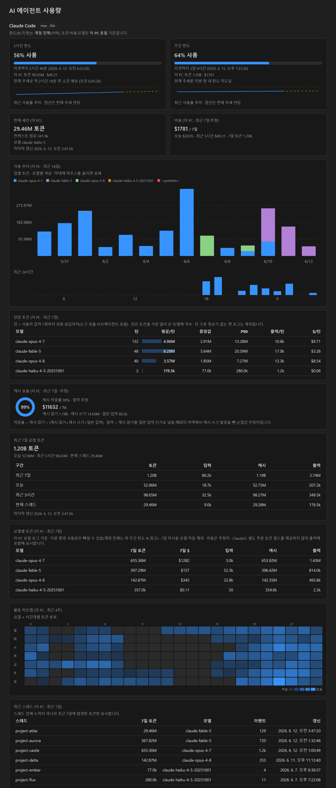
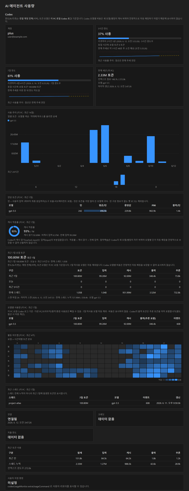

# AI Agent Usage Monitor (Codex + Claude)

See **Codex and Claude Code usage side by side**, always on, right in the VS Code status bar — plus a dashboard with limits, tokens, trends and activity.

Both agents work **without a separate login**: the extension reuses the credentials of the CLIs you are already signed in to.

- **Codex**: runs the local `codex app-server --stdio` and reads the current account, rate limits and tokens live (it never copies the `auth.json` token). Codex shows limits, tokens and models only — no cost.
- **Claude Code**: calls the same OAuth usage endpoint that the official `/usage` command uses, with the token in `~/.claude/.credentials.json`, to get the limit windows that apply to your account (5-hour, weekly, model-specific, …). Tokens and estimated cost are aggregated from the `~/.claude/projects/**/*.jsonl` transcripts. Expired tokens are refreshed automatically.

## Screenshots

**Claude Code section** — limit sparklines (dashed = current trend), 14-day usage trend stacked by model, tokens per turn by model (avg/median/P90/$), cache efficiency (hit rate and estimated savings), weekday × hour activity heatmap:



**Codex section** — the same trend / per-turn / heatmap views (no cost, by design):



> Token and chart numbers in the screenshots come from real local logs; account, limit percentages and thread names are sample/anonymized values. The UI follows the VS Code display language (English or Korean).

## Status bar

Two items on the left: `Codex …` and `Claude …`, each showing **remaining %** and the time until reset.

```
Codex   5h 80% (2h10m) · 7d 54% (3d2h)      plan with a 5-hour limit
Codex   5h none · 7d 53% (1d16h)            plan without a 5-hour limit
```

- The 5-hour slot is always first. If your plan (or the current period) has no 5-hour limit, it reads `5h none` instead of shifting the weekly value into that slot. When the server reports a 5-hour window again, the percentage reappears in the same place.
- The background turns yellow/red as a limit gets close (server-reported severity when available, otherwise 80% / 95%).
- Hover for gauges, exact reset times, the plan name and depletion estimates; click to open the dashboard.

## Features

- **Claude**: usage % and time to reset for every limit window the server reports (5-hour, weekly, model-specific weekly, … — only those that apply), plan display name (follows plan renames), tokens/cost for the last 5h / 7 days, current session tokens and context use, tokens/cost by model (7 days), **recent threads (this PC, 7 days)**, merging other environments
- **Codex**: connection/account (plan display name), limit windows classified by length (5-hour, weekly, …, including model-specific limits) with usage %, reset and window length, credits, spend limit, recent tokens, local 7-day tokens by model and thread, **merging other environments**, custom command output
- Tokens update in near real time via transcript file watching
- Optional notifications when a Claude limit window crosses configurable thresholds

### Visualizations (Claude and Codex)

Drawn as inline SVG with no external libraries, so they work offline and under strict CSP.

- **Usage trend**: daily tokens for the last 14 days stacked by model, plus hourly bars for the last 24 hours (hover for details)
- **Tokens per turn**: per model, the average / median / P90 / output tokens of one turn (user input → final answer, including tool calls and sub-agents), so you can tell whether one long turn pulled the average up. Claude also shows estimated $ per turn
- **Cache efficiency**: Claude shows a hit-rate donut and the estimated net savings (after the cache-write premium); Codex shows a hit-rate donut (`cached_input` is a subset of `input`; no $ estimate because Codex model IDs/aliases change too often for reliable price matching)
- **Activity heatmap**: token distribution by weekday × hour over the last 4 weeks
- **Limit sparklines**: recent utilization inside each limit card, with the current trend extended (dashed) and the projected 100% point

## Plans whose limits change

Which limit windows apply is decided by the server per plan and per period — for example, Codex suspended the 5-hour limit for some plans in July 2026 (restored for Plus, still off for Pro), and Claude removed it for verified Ultra accounts in October 2026. The extension therefore has no fixed "5-hour / weekly" slots in its data model: it shows only the windows the server reports, classified by **length or kind** — Codex by `windowDurationMins` (when there is no 5-hour window, the weekly window arrives in the first position, so position is never trusted), Claude by the `limits[]` meters of the usage response (`kind` / `group`; older servers fall back to the fixed fields). New meters appear without an extension update.

## Commands

- `AI Usage Monitor: Open dashboard`
- `AI Usage Monitor: Refresh` (Codex and Claude)
- `AI Usage Monitor: Reconnect Codex`
- `AI Usage Monitor: Refresh Claude`

## Settings

Codex

- `codexUsageMonitor.codexCommand`: Codex executable path/command (default `codex`; the binary bundled with the official OpenAI extension is used when found)
- `codexUsageMonitor.refreshIntervalSeconds`: Codex refresh interval (default `60` s)
- `codexUsageMonitor.extraUsageCommand`: show the output of a custom usage reporter command
- `codexUsageMonitor.codexExtraSessionPaths`: other environments' Codex `sessions` folders (or `.codex` homes) to include
- `codexUsageMonitor.showStatusBar`: show the Codex status bar item
- `codexUsageMonitor.notifyOnStartup`: one-time startup notice

Claude

- `codexUsageMonitor.showClaudeStatusBar`: show the Claude status bar item
- `codexUsageMonitor.claudeConfigDir`: Claude config folder (empty = `CLAUDE_CONFIG_DIR` or `~/.claude`)
- `codexUsageMonitor.claudePlanRefreshSeconds`: base refresh interval for plan limits (default `120` s, min 30 s). On HTTP 429 the interval doubles (up to 15 min) and converges back, never below this value
- `codexUsageMonitor.claudeTokenRefreshSeconds`: token re-aggregation interval (default `15` s, together with file watching)
- `codexUsageMonitor.claudeExtraProjectPaths`: other environments' `projects` folders to include
- `codexUsageMonitor.claudeUsageAlertThresholds`: notification thresholds in % (default `[80, 95]`, empty disables)

General

- `codexUsageMonitor.language`: `auto` (follow VS Code), `en` or `ko`

## Notes and limitations

- **Claude limits** are the same values `/usage` shows, but they come from an undocumented internal OAuth usage endpoint (the one the official Claude Code CLI uses). If it changes, limit display may stop working; local token/cost/model aggregation keeps working independently and the status bar falls back to local token info.
- **Claude cost (USD)** is an estimate at public per-model API prices, not what a subscription actually bills.
- **TLS / certificates**: requests follow VS Code's system certificate and proxy handling (`http.systemCertificates`, `http.proxy`). On newer extension hosts (Node 22+), OS certificates are merged in as well. Certificate verification is never disabled, to protect the OAuth token.
- **Data scope**: limit percentages are account-wide (all environments); tokens and models come from this PC's local logs. Add other environments' folders from the dashboard to merge them.
- **Large transcripts**: session logs can grow to hundreds of MB or more; they are parsed by streaming in chunks (no string-size limit) and incrementally for active sessions.
- **Depletion estimates** are only shown when the current trend reaches the limit before that window resets; otherwise the card says the limit won't be hit in this window.

Source, releases and Korean documentation: [github.com/kimbyungsu/codex-usage-monitor](https://github.com/kimbyungsu/codex-usage-monitor)
